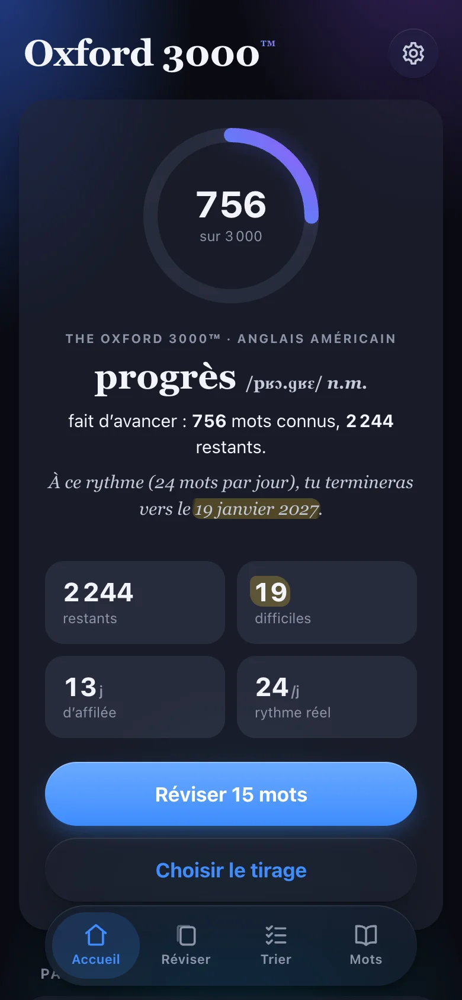
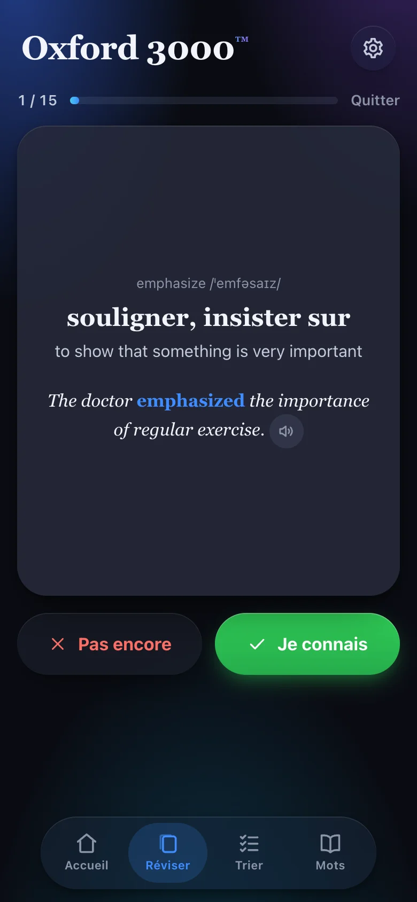
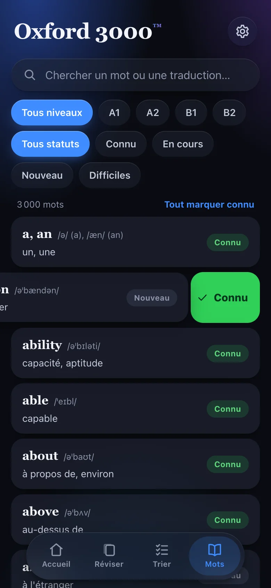

# Oxford 3000 — flashcards PWA

[](https://github.com/adrien-lebreton/oxford-3000/actions/workflows/ci.yml)
[](https://adrien-lebreton.github.io/oxford-3000/)


An offline-first Progressive Web App to learn the 3,000 core English words (*The Oxford 3000™, American English*), with progress tracking and a projected finish date based on your real learning pace. Built for French speakers, so the UI is in French.

**▶ Live demo: <https://adrien-lebreton.github.io/oxford-3000/>.** No account needed: your progress stays in your browser.

<table>
  <tr>
    <td align="center" width="33%"></td>
    <td align="center" width="33%"></td>
    <td align="center" width="33%"></td>
  </tr>
  <tr>
    <td align="center"><sub>Dashboard: known words, real pace, projected finish date per CEFR level</sub></td>
    <td align="center"><sub>Review card: IPA, audio, translation, plain-English definition, example</sub></td>
    <td align="center"><sub>Word list: swipe left to mark known, right to flag as difficult</sub></td>
  </tr>
</table>

## Features

- **Triage**: at the start, never-seen words scroll by one at a time so you can mark the ones you already know. Any of the last 15 decisions can be flipped without undoing the later ones.
- **Review**: random draws of 5 to 30 words by mode (new, not known, difficult, all), crossed with a CEFR level (A1 to B2). Keyboard shortcuts on desktop.
- **Difficult words**: flag them by hand, or let the app flag a word automatically after two misses. Auto-flagging happens once only: if you remove the flag, it never comes back.
- **Honest finish date**: computed from your actual pace over the last 14 days. Bulk-marked words are excluded, so the estimate can't be inflated.
- **Works everywhere, offline**: installable on iOS, Android and desktop. An optional account syncs progress across devices.

## Tech stack

React 19 · TypeScript (strict) · Vite 7 · vite-plugin-pwa (Workbox) · Vitest + Testing Library · Supabase (Postgres, Auth, Row Level Security) · GitHub Actions → GitHub Pages

Three runtime dependencies: `react`, `react-dom`, `@supabase/supabase-js`.

## Architecture

```text
src/
├── core/        Pure domain logic, no React: store, draw, stats, sync (unit-tested)
├── lib/         Supabase client: the only code that touches the network
├── ui/          React components; gesture maths split out into pure, tested modules
├── state.tsx    One React context: persistence and sync orchestration
└── data/        The 3,000-word lexicon, generated by scripts/ and bundled
scripts/         Data pipeline: official PDF text → validated JSON
```

A user action calls a pure function `(state, input, now) → state`. The new state is written to `localStorage` (debounced, 250 ms) and, when signed in, pushed to Postgres (debounced, 2 s).

## Design decisions

**Pure core, thin React.** Every rule (status transitions, draws, pace, merge) lives in `src/core/` as a pure function, and the current time (plus the random source for draws) is passed in as an argument. Tests are deterministic without mocking `Date`, and the core has no React import, so it could move to a React Native app unchanged.

**Offline-first: local is the source of truth.** The app works without an account or a network. A corrupted `localStorage` entry is saved aside under `oxford3000.v1.corrupt` instead of being silently lost, and imported files and the remote copy go through the same validator (`parseState`) as stored data.

**Sync without running a backend.** Supabase Postgres stores one row per user with the full progress state as `jsonb`, protected by Row Level Security ([`scripts/supabase.sql`](scripts/supabase.sql)). The anon key in `src/config.ts` is public by design: RLS is the security boundary. With an empty config, every account feature disappears from the UI.

**Conflict resolution: per-word last-write-wins, union of events.** On sign-in and on pull-to-refresh, the app pulls the remote copy, merges it with the local one, then pushes the result. For each word, the most recent version wins; the review log is a de-duplicated union, sorted by time and capped at 20,000 events. Merging the same data twice changes nothing, and pull-to-refresh only replaces the state when the merge actually changes it.

**A pace metric that stays honest.** Pace counts *net* transitions to "known" from real reviews over 14 days: a known word you miss counts −1. With fewer than 5 data points, the estimate falls back to an adjustable daily goal, so it never divides by zero or shows a wild number on day one.

**No router, no state manager.** Four tabs and a settings modal: one React context is enough, and every dependency avoided is one less thing to upgrade.

**Gestures as pure maths.** Swipe thresholds (engage after 14 px, trigger at 76 px or on a fling ≥ 0.55 px/ms, elastic damping past the threshold) and the pull-to-refresh curve live in `swipe-gesture.ts` and `pull-refresh.ts`, tested without a DOM. Components only wire Pointer Events, and `touch-action: pan-y` keeps native vertical scrolling.

**New releases reach tabs left open.** Browsers only re-fetch a service worker on navigation, so a PWA left open on a phone never sees a deploy. `main.tsx` checks for an update every 60 s (skipped offline), and Workbox reloads the page once the new version activates.

**Audio with zero assets.** Pronunciation uses the Web Speech API (en-US voice): it works offline on macOS, iOS and Android, with no audio file to ship.

**Accessibility.** The hidden face of a flashcard is `inert` (neither focusable nor read by screen readers), statuses are spelled out rather than shown by colour alone, and the whole review flow works from the keyboard.

## Data pipeline

The lexicon is built offline by the scripts in `scripts/`:

1. `pdftotext` on the official OUP PDF → `data/raw.txt`.
2. `parse.mjs` → `data/base.json`: exactly **3,000 entries** (A1 900, A2 800, B1 700, B2 600, matching the official counts). It handles entries split over two lines, homographs (`close¹`/`close²`), notes (`bank (money)`) and case collisions (`it`/`IT`).
3. Enrichment in batches of 250: General American IPA, French translation, plain-English definition, example sentence. A second pass covers the ~700 polysemous words with one block per secondary sense.
4. `merge.mjs` fails on any missing, unknown or duplicate id (3,000/3,000 coverage), reports quality issues (IPA format, empty or overlong fields, a word missing from its own example, incomplete secondary senses), and writes `src/data/words.json`.

## Tests and CI

Unit and component tests (Vitest + Testing Library) cover status transitions and auto-flagging, draws (size, uniqueness, filters), pace and finish-date estimation (14-day window, bulk exclusion, fallback), sync merging, serialization and corrupted-state recovery, gesture maths, keyboard handling during a review session, and card accessibility.

[GitHub Actions](.github/workflows/ci.yml) type-checks, tests and builds every push and pull request. The site is deployed to GitHub Pages only from `main`, and only when all of that passes.

## Run locally

Requires Node 22+.

```bash
npm install
npm run dev        # http://localhost:5188
npm test           # vitest
npm run build      # type-check + production build in dist/
npm run preview    # serve the production build
```

## Known limitations and next steps

- Sync is last-write-wins on device clocks. Server-side timestamps, or one row per word, would remove clock-skew edge cases.
- The whole lexicon ships in the main JS bundle (~360 kB gzipped overall) so the app is fully offline after the first visit. Lazy-loading it would speed up the first paint.
- No spaced repetition yet: SM-2 scheduling is the natural next step.
- Voice quality depends on the OS (excellent on Apple devices, uneven elsewhere).

Original design notes, in French: [`docs/design.md`](docs/design.md).

## Credits

Word list: *The Oxford 3000™ (American English)*, © Oxford University Press. This is an independent personal project, not affiliated with or endorsed by OUP.

Built by [Adrien Le Breton](https://adrien-lebreton.github.io/me/).
